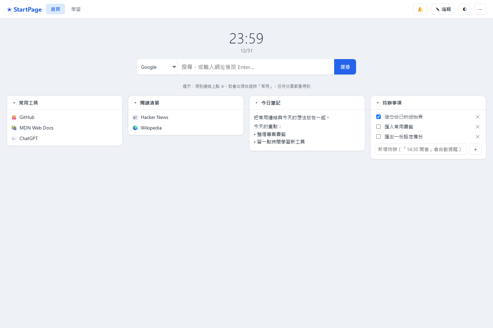
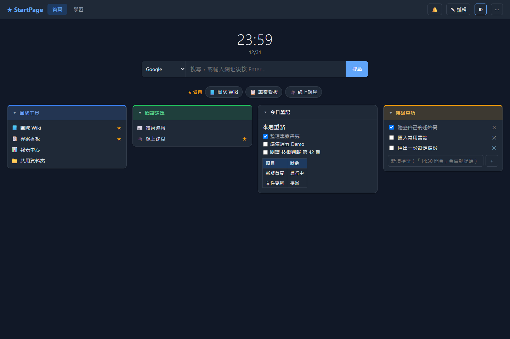
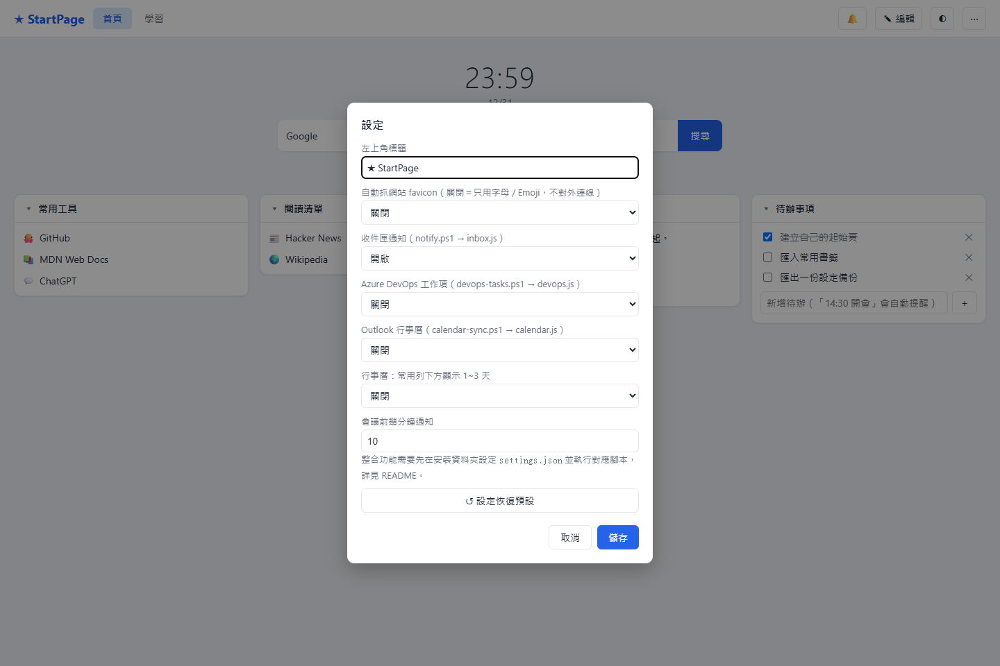
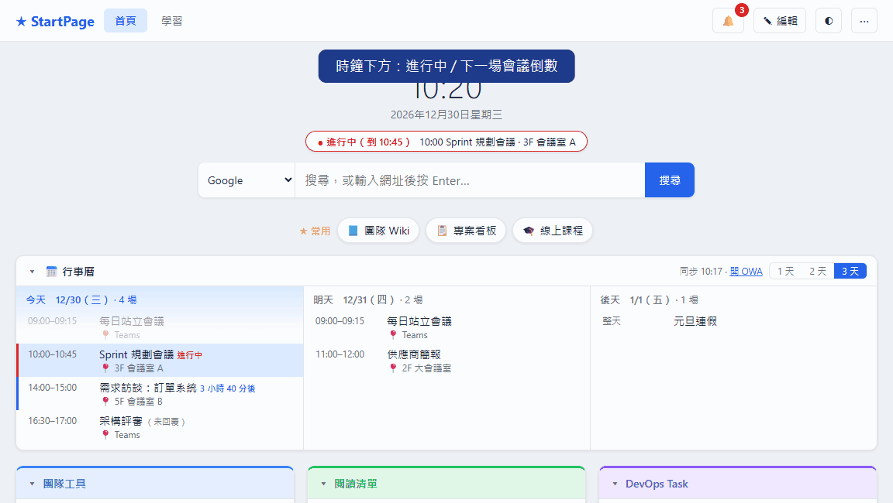
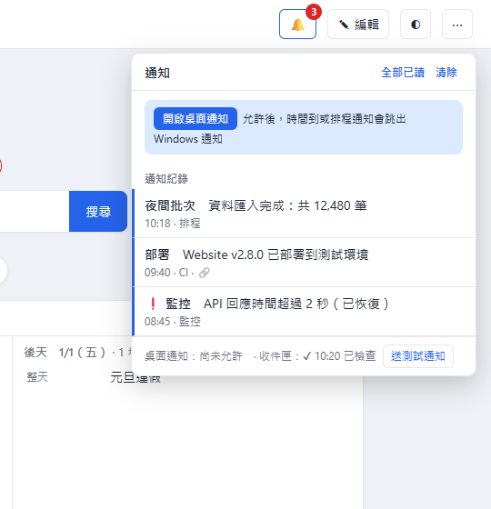
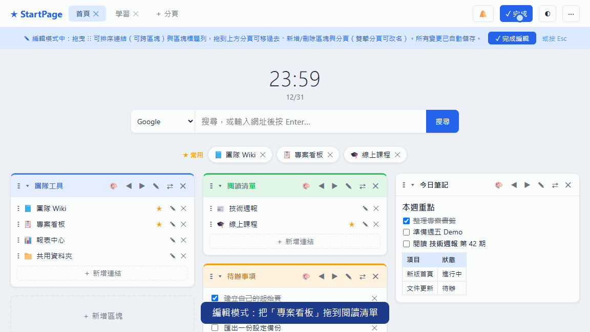
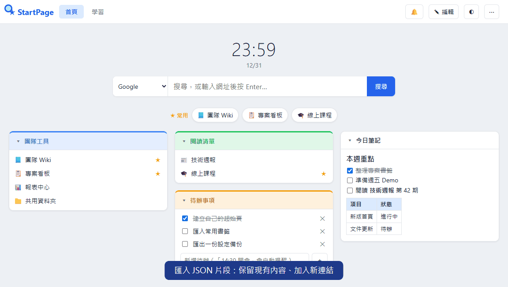

# StartPage

單檔 HTML 瀏覽器起始頁，可直接安裝，也可以交給 AI 當 Skill 使用

**把每天會用到的連結、筆記、待辦、通知和會議放在同一頁。不用架伺服器、不用註冊帳號，資料只存在你的瀏覽器裡。**

**線上試用（虛構資料，不用安裝）：<https://jungkang0911.github.io/StartPage/>**



## 特色

- **一個 HTML 檔就能用**：不需要 Node.js、資料庫或網站伺服器，雙擊 `index.html` 就能開。
- **資料在自己手上**：書籤、筆記和待辦都存在瀏覽器 `localStorage`，本專案不會上傳任何資料。
- **設定都開放**：標題、搜尋引擎、favicon、各項整合功能都能在頁面「⋯ → ⚙ 設定」切換，也可以用 `options.js` 統一派送給整個團隊。
- **選用的本機整合**：PowerShell 腳本可以把排程通知、Azure DevOps 工作項、Outlook 會議送進頁面，用不到就關掉。
- **AI 友善**：附 `SKILL.md`。AI 只會照固定範本安裝，不會每次產生不同版型。

| 功能 | 說明 |
| --- | --- |
| 分頁與書籤區塊 | 依工作、學習或生活整理連結；區塊可以設顏色、收合 |
| ★ 常用列 | 連結加星號後，會顯示在搜尋列下方，每個分頁都看得到 |
| 筆記（Markdown） | 支援標題、清單、勾選框、表格、程式碼；網址和本機路徑會自動變成連結 |
| 待辦與提醒 | 輸入「14:30 開會」會自動設定提醒，時間到跳出桌面通知 |
| 🔔 通知中心 | 收集待辦提醒、腳本送來的通知（`notify.ps1`）和會議提醒 |
| 拖曳排序 | 在編輯模式拖曳連結（可以跨區塊）或區塊；拖到上方分頁標籤可以移過去 |
| 本機路徑 | `D:\資料夾`、`\\server\share\檔.xlsx` 都能存，也可以一鍵複製路徑 |
| 匯入／匯出 | 支援設定 JSON 和瀏覽器匯出的書籤 HTML |
| 深色／淺色 | 右上角 ◐ 切換 |



## 線上試用

打開 <https://jungkang0911.github.io/StartPage/> 就能操作：編輯、拖曳、筆記、待辦都能試，行事曆、DevOps、通知顯示的是虛構資料。你改的內容只存在自己的瀏覽器，「⋯ → 重設為預設內容」可以還原。

## 安裝

### Windows：一行指令

在 PowerShell 執行（會裝到 `%USERPROFILE%\StartPage`）：

```powershell
irm https://raw.githubusercontent.com/jungkang0911/StartPage/main/scripts/web-install.ps1 | iex
```

想裝到別的資料夾：

```powershell
$env:STARTPAGE_TARGET = 'D:\StartPage'; irm https://raw.githubusercontent.com/jungkang0911/StartPage/main/scripts/web-install.ps1 | iex
```

再執行一次同一行指令就是更新。`options.js`、`settings.json` 這些個人設定，以及瀏覽器裡的資料都會保留。

### Windows：從原始碼安裝

```powershell
git clone https://github.com/jungkang0911/StartPage.git
cd StartPage
powershell -NoProfile -ExecutionPolicy Bypass -File .\scripts\install.ps1                      # 預設位置
powershell -NoProfile -ExecutionPolicy Bypass -File .\scripts\install.ps1 -Target D:\StartPage  # 指定資料夾
powershell -NoProfile -ExecutionPolicy Bypass -File .\scripts\install.ps1 -Config .\examples\default.json  # 附範例內容
```

`-NoIntegrations` 只安裝頁面，不複製整合腳本。

### macOS／Linux

```sh
curl -fsSL https://raw.githubusercontent.com/jungkang0911/StartPage/main/scripts/install.sh | sh
# 或：sh scripts/install.sh ~/Sites/start
```

裝好後，用 Edge、Chrome 或 Firefox 開啟輸出的 `file:///…/index.html`。

### 安裝後的資料夾

```text
index.html          頁面（每次更新都會覆蓋，舊版備份成 index.html.bak）
options.js          功能設定（只在第一次安裝時建立，之後不覆蓋）
config.js           首次開啟的預設內容（用 -Config 時才產生）
settings.json       整合腳本的設定（EWS 網址、DevOps 組織、ntfy）
notify.ps1          送通知、待辦、筆記到頁面
devops-tasks.ps1    同步 Azure DevOps 工作項
calendar-sync.ps1   同步 Outlook／Exchange 行事曆
```

## 平台支援

| 項目 | Windows | macOS／Linux |
| --- | --- | --- |
| 頁面本身（書籤、筆記、待辦、提醒、匯入匯出） | ✔ | ✔（任何現代瀏覽器） |
| 一行安裝 | `web-install.ps1` | `install.sh` |
| `notify.ps1` 通知／待辦 | ✔ | 安裝 [PowerShell 7](https://learn.microsoft.com/powershell/scripting/install/installing-powershell)（`pwsh`）後可用 |
| `devops-tasks.ps1` | ✔ | `pwsh` 加 Azure CLI 可用；`-Install` 排程只支援 Windows（其他平台改用 cron） |
| `calendar-sync.ps1` | ✔（用目前登入的 Windows 帳號連 Exchange） | ✖ |
| 本機路徑連結 `D:\…`、`\\server\…` | ✔ | 不適用 |

## 設定

設定有三層，上面的會蓋掉下面的：

1. 頁面「⋯ → ⚙ 設定」：存在瀏覽器裡，會跟著匯出／匯入一起帶走
2. 安裝資料夾的 `options.js`：適合統一派送給團隊
3. 內建預設值



`options.js`（完整範例見 [examples/options.example.js](examples/options.example.js)，只寫要改的項目即可）：

```javascript
window.STARTPAGE_OPTIONS = {
  title: '★ 我的首頁',
  favicon: true,          // 自動抓網站 /favicon.ico；預設 false，只用字母／Emoji，不對外連線
  devops: true,           // 開啟 DevOps 區塊
  calendar: true,         // 開啟 Outlook 會議倒數與會前通知
  calendarRemind: 10,
  engines: [['Google', 'https://www.google.com/search?q='], ['Bing', 'https://www.bing.com/search?q=']],
};
```

| 選項 | 預設 | 說明 |
| --- | --- | --- |
| `title` | `★ StartPage` | 左上角文字 |
| `favicon` | `false` | `true` 時向各網站請求 `/favicon.ico`，內網站台也適用 |
| `engines` | Google、Bing、DuckDuckGo、GitHub、StackOverflow | 搜尋引擎清單，格式為 `[名稱, 查詢網址]` |
| `inbox` / `inboxSec` | `true` / `10` | 每隔幾秒讀一次 `inbox.js`（`notify.ps1` 產生） |
| `devops` / `devopsSec` | `false` / `60` | DevOps 區塊，讀 `devops.js` |
| `calendar` / `calendarSec` | `false` / `60` | 行事曆，讀 `calendar.js` |
| `calendarRemind` | `10` | 會議開始前幾分鐘通知 |
| `calendarStrip` | `false` | 在常用列下方顯示 1~3 天的行事曆 |

### 預設內容（config.js）

`config.js` 只在瀏覽器還沒有資料時（第一次開啟）生效。格式參考 [examples/default.json](examples/default.json)，通常用 `install.ps1 -Config xxx.json` 產生。如果瀏覽器已經有資料，請改用「⋯ → 匯入」。

## 整合功能（選用）



開啟行事曆後，時鐘下方會顯示進行中或下一場會議；開了 `calendarStrip` 的話，常用列下方還會顯示 1~3 天的行程。DevOps 區塊會依專案分組列出指派給你的未結工作項，過期的到期日標成紅色。右上角 🔔 會累積各種通知。

整合腳本都會寫一個 `.js` 檔到安裝資料夾，頁面定時重新讀取。因為 `file://` 頁面不能用 fetch，所以改用 `<script>` 載入。設定寫在同資料夾的 `settings.json`（範本：[examples/settings.example.json](examples/settings.example.json)）：

```json
{
  "calendar": { "ewsUrl": "https://mail.example.com/EWS/Exchange.asmx", "days": 7 },
  "devops":   { "org": "https://dev.azure.com/my-org", "project": "", "types": ["Task"] },
  "ntfy":     { "url": "https://ntfy.sh/my-topic" }
}
```

`settings.json` 和腳本產生的 `inbox.js`、`devops.js`、`calendar.js` 都是個人資料，已列在 `.gitignore`。

### 通知、待辦、筆記：notify.ps1

讓排程、批次或 AI 工具把訊息送進起始頁：

```powershell
& "$env:USERPROFILE\StartPage\notify.ps1" "夜間批次完成"
& "$env:USERPROFILE\StartPage\notify.ps1" "匯入失敗：連線逾時" -Title "夜間批次" -Priority high
& "$env:USERPROFILE\StartPage\notify.ps1" "報表已產生" -Click "D:\Report\今日.xlsx"
& "$env:USERPROFILE\StartPage\notify.ps1" "回覆週報" -Todo          # 加到待辦清單
& "$env:USERPROFILE\StartPage\notify.ps1" "會議紀錄：D:\Notes\a.md" -Note   # 附加到筆記
```



`-Priority min|low` 只記錄、不跳通知；`high|urgent` 的通知不會自動消失。`settings.json` 填了 `ntfy.url` 的話，會同時推播到 [ntfy](https://ntfy.sh)，手機也收得到。

### Azure DevOps 工作項：devops-tasks.ps1

需要 [Azure CLI](https://learn.microsoft.com/cli/azure/install-azure-cli)，並先執行 `az login`。腳本用 az 的 token，不會存密碼。

```powershell
& "$env:USERPROFILE\StartPage\devops-tasks.ps1"            # 先手動跑一次
& "$env:USERPROFILE\StartPage\devops-tasks.ps1" -Install   # 建立工作排程（每 30 分鐘、登入時各跑一次）
```

接著在頁面「⚙ 設定」開啟 DevOps，再用「＋ 新增區塊 → DevOps Task」加到想放的分頁。

### Outlook 行事曆：calendar-sync.ps1

用目前登入的 Windows／AD 帳號連 Exchange Web Services（EWS），不存密碼。第一次執行會自動從 NuGet 下載 `Microsoft.Exchange.WebServices.dll`（MIT 授權）到 `lib\`。

```powershell
& "$env:USERPROFILE\StartPage\calendar-sync.ps1" -Install   # 每 10 分鐘同步
```

開啟後，時鐘下方會顯示「下一場會議」倒數，會議前會跳通知。只支援有開 EWS 的 Exchange（地端或 Exchange Online 的整合驗證環境）。

## 日常操作

### 拖曳連結，跨區塊整理



### 匯入設定，加入新連結



1. 按「✎ 編輯」新增分頁、書籤區塊和連結；🎨 可以改區塊顏色。
2. 在編輯模式拖曳排序；拖到分頁標籤可以跨分頁移動。
3. 筆記和待辦會自動儲存；筆記點一下就能編輯，離開後顯示 Markdown 排版。
4. 「⋯ → 匯出設定」可以備份，換瀏覽器或換電腦時再匯入。

完整 JSON（含 `pages`）會取代目前所有設定，匯入前頁面會先確認；只有 `widgets` 的片段則是合併進去，相同網址會略過。

## 從 Edge／Chrome 書籤建立預設內容

```powershell
.\scripts\bookmarks-to-config.ps1 -List                                    # 只列資料夾和連結數，不列網址
.\scripts\bookmarks-to-config.ps1 -Folders '書籤列/工作','書籤列/學習' -Out .\my-default.json
.\scripts\install.ps1 -Config .\my-default.json
```

加上 `-Browser Chrome` 改讀 Chrome。如果不是 Default 設定檔，用 `-Path` 指定 Bookmarks 檔。

## 設成瀏覽器首頁

在 Edge／Chrome 的啟動設定選「開啟特定頁面」，填入安裝時輸出的 `file:///` 網址；首頁按鈕也可以填同一個網址。「新分頁」通常要另裝擴充功能才能指定。公司電腦如果被原則鎖住，可以改成加到書籤列或釘選分頁。

## 交給 AI 安裝

把整個專案放進 AI 工具的 skills 目錄（`assets/`、`scripts/`、`integrations/`、`examples/` 都要一起放），或直接把 `SKILL.md` 的位置給它。可以這樣說：

> 用 startpage Skill 幫我安裝起始頁，並從 Edge 書籤挑資料夾當預設內容。

> 更新我的起始頁，保留原本的位置和設定。

> 幫我開啟 DevOps 整合，組織是 https://dev.azure.com/my-org。

## 資料與隱私

- 個人資料存在瀏覽器 `localStorage`，key 是 `startpage.v1`。清除瀏覽資料、換瀏覽器或移動 HTML 的路徑，都可能看不到舊資料，請先匯出備份。
- 更新時請用同一個安裝路徑。
- favicon 預設關閉，頁面不會主動連到書籤網站；只有搜尋、點連結和你自己指定的圖片網址會連外。
- 請不要把個人設定、內部網址或 Token 提交到公開的 repository。

## 專案結構

```text
assets/index.html                 唯一的頁面範本
examples/default.json             範例內容（不含個資）
examples/options.example.js       功能設定範本 → options.js
examples/settings.example.json    整合腳本設定範本 → settings.json
scripts/web-install.ps1           Windows 一行安裝
scripts/install.ps1               Windows 安裝／更新
scripts/install.sh                macOS／Linux 安裝
scripts/bookmarks-to-config.ps1   書籤轉預設內容
scripts/*.cjs, encode-demo.py     產生 README 截圖與 GIF（虛構資料）
integrations/notify.ps1           通知／待辦／筆記
integrations/devops-tasks.ps1     Azure DevOps 工作項
integrations/calendar-sync.ps1    Outlook 行事曆
SKILL.md                          給 AI 的使用指引
docs/                             GitHub Pages 線上試用（scripts/build-pages.ps1 產生）
docs/images/                      截圖
```

採用 [MIT License](LICENSE)。
